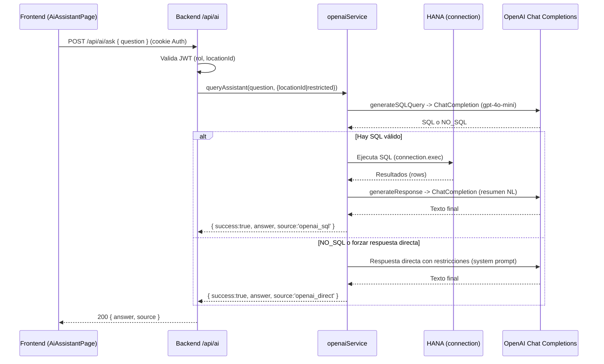

## Sapitos IA: Diagrama y funcionamiento del ChatGPT/OpenAI

Esta guía explica cómo está integrada la IA (OpenAI) en el backend, qué rutas expone y cómo fluye la información desde el frontend hasta OpenAI y de vuelta.

### Módulos y archivos relevantes

- Backend
  - `backend/Ai_OpenAI/openaiService.js`: lógica principal de IA
    - Inicialización de OpenAI (`initializeOpenAI`)
    - Generación de SQL desde lenguaje natural (`generateSQLQuery`)
    - Ejecución de SQL en HANA (`executeSQLQuery`)
    - Respuesta final en lenguaje natural (`generateResponse`)
    - Orquestador (`queryAssistant`) con dos rutas posibles: SQL-first o respuesta directa
  - `backend/Ai_OpenAI/aiController.js`: controladores HTTP
    - `askAssistant` (POST /api/ai/ask)
    - `getAIStatus` (GET /api/ai/status)
    - `initializeAI` en carga del módulo
  - `backend/Ai_OpenAI/aiRoutes.js`: router Express
  - `backend/app.js`: monta las rutas en `/api/ai`
  - `backend/config/db.js`: conexión HANA (usada por `executeSQLQuery`)
  - `backend/logs/app_*.log`: logs donde se ve la inicialización y llamadas a OpenAI
- Frontend
  - `frontend/src/pages/AiAssistantPage.jsx`: UI del chat que llama a `POST http://localhost:5000/api/ai/ask` con cookies (Auth)

### Autenticación y contexto de usuario

- `aiController.askAssistant` lee el token `Auth` desde cookies y lo valida con `JWT_SECRET`.
- Extrae `rol` y `locationId` del token para aplicar restricciones:
  - `admin`: sin restricciones
  - `dueno` o `proveedor`: restringe a su `Location_ID`
  - otros: modo restringido por defecto

### Flujo de consulta (sequence)



### ¿Es un chat lineal o “manda-procesa-devuelve”?

- Es de tipo manda-procesa-devuelve por cada pregunta. Cada mensaje que envías se procesa completo y la respuesta se genera a partir de:
  1) tu texto, 2) reglas y contexto del sistema (rol, ubicación), y 3) resultados SQL si corresponde.
- No mantiene una memoria larga de la conversación en el backend. El estado relevante (rol, locationId) se toma del JWT en cada request.
- Si quieres “hilo” o contexto extendido, el frontend debería incluir mensajes previos en el body, o implementar un almacenamiento de historial y reenviarlo en la solicitud.

### Cómo “piensa” el asistente (versión simple)

1) Entiende la pregunta: ¿hay palabras que indican que debo consultar la base de datos? (pedidos, ventas, inventario, etc.)
2) Si debe usar datos, intenta convertir la pregunta a SQL válido para HANA y agrega el filtro de tu ubicación cuando es necesario.
3) Si el SQL es válido: ejecuta la consulta; si falla, explica el error y sugiere cómo reformular.
4) Resume los resultados en lenguaje natural, claro y con cifras.
5) Si no debe/puede usar datos, responde directamente con conocimiento del dominio y las restricciones de tu ubicación.

#### Diagrama mental (fácil de explicar)

```mermaid
flowchart TD
  Q[Tu pregunta] --> D{¿Necesita datos\n(reporte, totales, listas)?}
  D -- Sí --> SQL[Generar SQL (HANA)\n+ aplicar Location_ID]
  SQL --> E{¿SQL válido?}
  E -- Sí --> RUN[Ejecutar SQL en DB]
  RUN --> RES[Resultados en tabla]
  RES --> NAT[Redacta respuesta clara\ncon números y fechas]
  E -- No --> HELP[Explica error y sugiere\nreformulación]
  D -- No --> DIRECT[Responde directo con\nreglas del dominio]
  HELP --> OUT[Respuesta]
  NAT --> OUT
  DIRECT --> OUT
```

### Reglas importantes del generador de SQL

En `openaiService.generateSQLQuery`:
- Modelo: `gpt-4o-mini` (Chat Completions, `openai` v4)
- Instrucciones de sistema con:
  - Esquema de tablas (DB_SCHEMA) y ejemplos SQL (EXAMPLE_REWARD_QUERIES)
  - Reglas por rol/ubicación: fuerza `Location_ID = <id>` cuando corresponda
  - Reglas de formato: solo SQL, sintaxis HANA, NO usar backticks
- Si la respuesta comienza con `NO_SQL:` se considera no convertible.
- Si falta el filtro de ubicación, se inyecta automáticamente en la cláusula WHERE u antes de ORDER BY/GROUP BY/HAVING/LIMIT.

### Manejo de errores y fallback

- Sin `OPENAI_API_KEY` en variables de entorno: `initializeOpenAI` registra error y retorna `false`.
- Errores al ejecutar SQL: se pide a OpenAI explicar el error y cómo reformular la pregunta, y se retorna `success:false` con el mensaje.
- Si no se puede generar SQL y la pregunta “debería” hacerlo (palabras clave), se intenta reformular y reintentar; si aún falla, se responde directo vía OpenAI con un sistema especializado por dominio.

### Endpoints expuestos

- `POST /api/ai/ask`
  - Body JSON: `{ question: string }`
  - Requiere cookie `Auth` válida (JWT), usa `JWT_SECRET`.
  - Respuesta:
    - `200 { success: true, answer: string, source: 'openai_sql'|'openai_direct' }`
    - `4xx/5xx { success:false, message|error }`
- `GET /api/ai/status`
  - Indica si OpenAI está inicializado (conectado) en backend.

### Variables de entorno (backend/.env)

- `OPENAI_API_KEY` — clave para el SDK oficial (`openai` v4)
- `JWT_SECRET` — validación de la cookie `Auth`
- Conexión HANA (para SQL cuando aplica): `SERVER_NODE`, `DB_USERNAME`, `DB_PASSWORD`

Importante: no commitees claves reales. En producción, usa Key Vaults/Secret Managers.

### Logs y observabilidad

- Inicialización y llamadas a OpenAI quedan en `backend/logs/app_YYYYMMDD.log`.
- El servicio también registra consultas SQL generadas/modificadas y resultados.
- Sistema de “recompensa”: cuando una consulta SQL es exitosa, se registra e informa a OpenAI con un mensaje “RECOMPENSA” (no persistente, solo heurístico).

### Notas de seguridad y privacidad

- Para roles restringidos se impone `Location_ID` en las consultas; además, el sistema prompt recalca el alcance de datos.
- No envíes datos sensibles innecesarios a OpenAI. El flujo actual serializa resultados SQL a JSON para resumir; considera anonimizar campos sensibles si aplica.

### Mejoras sugeridas

- Validar SQL con parser antes de ejecución (lista blanca de tablas/columnas).
- Rate limiting y tracing por usuario/rol.
- Telemetría estructurada (tiempos de prompt, tokens, latencia DB, errores categorizados).
- Cache de respuestas comunes con invalidación por cambios recientes.
